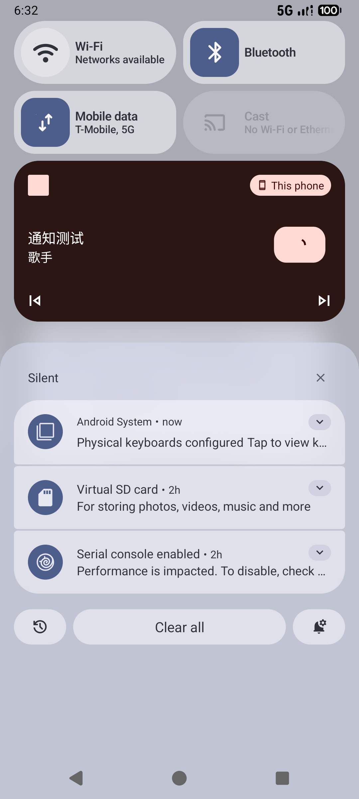

# Android 后台播放 / 通知 取证（2026-11-19）

> 环境：Android 模拟器 Medium_Phone（emulator-5554, Android SDK 36）；App 为 debug 构建；探针入口播放本地真实 mp3（audiotags 同包）。

## 结论（实测）

| 项 | 结果 | 证据 |
|---|---|---|
| 媒体会话 | `package=com.resonance.app, active=true, state=PLAYING(3)`，metadata=「通知测试 / 歌手」 | `media_session_playing.txt` |
| 媒体键/传输控制 | `cmd media_session dispatch play-pause`：`PLAYING(3)` → `PAUSED(2)`（position 81→162） | `media_session_paused.txt` |
| 前台服务/后台保活 | `AudioService isForeground=true foregroundId=1124 types=0x2`，channel=`com.resonance.app.channel.audio` | `audio_service_foreground.txt` |
| 通知样式 | Notification id=1124，channel=`com.resonance.app.channel.audio`「回响播放」，title=「通知测试」，动作 Previous/Pause/Next | `notification.txt`、`notif_shade.png` |
| 锁屏媒体控件 | ❌ 本次未取到：模拟器 SystemUI 无响应（ANR），见 `lock_systemui_anr.png` | 待复验 |

## 复现方式

1. `flutter test integration_test/audio_service_e2e_test.dart -d emulator-5554`（+1，27s 通过；播放 25s 供取证）。
2. 取证命令：`adb shell dumpsys media_session`、`dumpsys activity services com.resonance.app`、`dumpsys notification --noredact`、`adb shell cmd statusbar expand-notifications` + `screencap`。
3. 媒体键：`adb shell cmd media_session dispatch play-pause`（与耳机媒体键同一会话路径）。

## 截图

（锁屏截图因 SystemUI ANR，见 `lock_systemui_anr.png`，待复验。）
